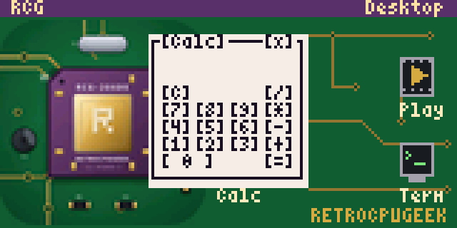

# Contiki's desktop on the card10

[Contiki](https://github.com/contiki-os/contiki)'s desktop, CTK, as a native
app (an l0dable) on the card10 badge's core 1, on Epicardium's API, with a
RetroCPUGeek theme: the RetroCPUGeek avatar's chip on a circuit board as the
backdrop, an RCG menu, and a window naming the chip it really runs on, the
card10's MAX32666. Its serial terminal talks to core 0 both ways: API calls
out, and interrupts in; its animation player shares the work between the
cores: core 0 decodes the frames, core 1 shows them.

On the v86-arm site: `?build=card10-ctk` starts it; on `?build=card10` it's
in the badge's menu as "Contiki desktop (RCG)".

- `main.c`: Contiki's platform (clock, main loop), keys from the buttons, the
  touch panel as CTK's mouse, and the desktop: icons and the RCG menu for
  Contiki's calculator, process list and about box, the RetroCPUGeek
  window, the serial terminal and the player.
- `serial.c`: the serial terminal (the Term icon, or "Serial terminal" in
  the RCG menu) on the badge's console, the page's console in the emulator.
  A character arriving there makes Epicardium raise `EPIC_INT_UART_RX` on
  core 1; its handler, `epic_isr_uart_rx()`, takes the input with
  `epic_uart_read_str()` and polls the terminal's process, which shows it and
  echoes it back with `epic_uart_write_str()`. Hello and Time write to the
  console; the window counts the interrupts and the bytes each way. (Ctrl-C
  in the console still stops the app, as Epicardium does with any app.)
- `player.c`: the animation player (the Play icon, or "Player" in the RCG
  menu). Core 0 reads and decodes each frame (Epicardium's animation
  decoder, `../epicardium-anim.patch`: a FreeRTOS task of its own, and
  `epic_anim_open()`, `epic_anim_decode()`, `epic_anim_close()`); core 1
  asks for the next frame into one buffer and shows the other.
  `epic_anim_decode()` returns at once; when the frame is there, core 0
  raises `EPIC_INT_ANIM_FRAME`, whose handler, `epic_isr_anim_frame()`,
  polls the player's process. At each tick the player shows the frame
  that's ready (in the window's `CH_VIDEO` cells, `conio_video()`), and
  counts as late a tick with none ready. Next goes to the next animation in
  `/apps/ctk/anims`; Pause and Close.
- `gen-anims.py` makes the animations (`../build.sh` runs it): `.rla` files
  of 96 x 42 pixels, a 256-colour palette and PackBits (the format is in
  the patch's `epicardium.h`): a plasma, a turning cube and the
  RetroCPUGeek chip on a circuit board.
- `conio-card10.c`: the character screen CTK draws on (through its
  `ctk-conio.c`): 40 x 13 cells of 4 x 6 pixels on the 160 x 80 display,
  with line characters for the window frames, icon tiles, the backdrop and
  the player's picture.
- `contiki-conf.h`: Contiki's configuration (keys, colours, sizes).
- `contiki-ctk-conio.patch`: icons and the desktop in their own colours.
- `gen-assets.py` makes `assets.h`: the X11 misc-fixed 4x6 font (public
  domain), the backdrop (from `retrocpugeek.png`) and the icons.
- `meson.build`, `metadata.json`: built in the firmware's tree as
  `l0dables/ctk`, by `../build.sh`, which also puts it on the badge's file
  system (`/apps/ctk`, with `execute_elf = true` in `card10.cfg`).

Buttons: bottom left and right move between widgets (or menu items), top
right selects; held, top right opens and closes the menus, bottom right
goes to the next window (in the menus, the next menu) and bottom left closes
the window in front.

Touch: the emulator gives its card10 a touch panel (an FT6x36 on the
badge's I2C bus, `src/cm/src/dev/max32665.rs`, 640 x 320 points), which
Epicardium reads with `epic_touch_read()` (`../epicardium-touch.patch`) and
the page feeds from the pointer on the badge's screen. Tap a widget, an icon
or a menu; tap a window's title, then where it should go.

Debugging: `?build=card10-ctk&debug` (or `?build=card10&debug`, then start
the desktop from the badge's menu). The gdb-wui image has `ctk.elf` with its
debug info and sources (`../build.sh`'s debug bundle), and core 1's gdb loads
its symbols where Epicardium's loader always puts it, 0x20040000
(`add-symbol-file ctk.elf -o 0x20040000`, `tools/gdb-wui-guest/S95gdb-wui`),
next to Pycardium's (in flash, so the pc tells them apart). Break on
`poll_buttons`, `conio_flush`, `calc_process`'s thread function,
`epic_isr_uart_rx` (then type in the console), `epic_isr_anim_frame` (with
the player open) and so on; on core 0, `vAnimTask` and `decode_next`
(`epicardium/modules/anim.c`).
Contiki's processes are protothreads: their locals don't live across a wait,
so watch their `static`s instead.

Tests: `tests/cm/card10-ctk.mjs` (the page);
`BUILD=card10-ctk CALL=epic_buttons_read CALLER=poll_buttons tests/guest-web/card10-debug.mjs`
(the debuggers); natively,
`card10run --keys 'rt@19:0.8,...' --touch 'X,Y@S,...'`.

Contiki is BSD-3-Clause (its `LICENSE`, copied into the build); the
RetroCPUGeek avatar is its owner's.
