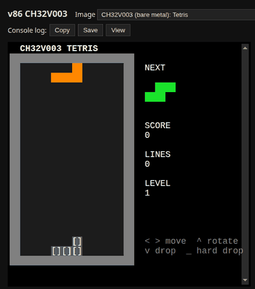

# CH32V003 firmware

Bare-metal firmware for the WCH CH32V003 (QingKe V2A, RV32EC, 2 KB of SRAM,
16 KB of flash), run by v86's RISC-V core as `arch: "ch32v003"`
(`src/rv64/src/dev/ch32.rs`) and on the v86-riscv site.

`tetris.c` is Tetris over USART1 (115200 8N1, TX on PD5, RX on PD6) for an
ANSI terminal: 10 x 20 board, 7-bag randomizer, ghost piece, levels. Keys:
arrows or a/d/w/s, space hard drop, z rotate back, p pause, r restart. It
runs from a 10 ms SysTick interrupt and sleeps (`wfi`) in between, and only
redraws what changed.



[Play it](https://v86-riscv.turret13.workers.dev/?build=ch32v003-tetris), or
[debug it](https://v86-riscv.turret13.workers.dev/?build=ch32v003-tetris&debug):
gdb-wui stopped at a breakpoint in `draw()`, next to the game
([screenshot](media/tetris-debug.png)).

No SDK: `start.S` (reset entry), `link.ld`, `ch32v003.h` (the registers
used) and `libgcc.c` (multiply, divide, memset, memcpy for RV32EC). The
same image should run on a real CH32V003 with a USB-serial adapter on
PD5/PD6 (flash it with e.g. minichlink); that hasn't been tried yet.

```sh
CROSS=riscv32-buildroot-linux-gnu- tools/ch32v003/build.sh     # any rv32ec-capable GCC
src/rv64/target/release/rv64run --ch32v003 build/ch32v003/tetris.bin
tests/rv64/ch32v003.mjs
tools/rv64-site/add-mcu.sh ch32v003-tetris "CH32V003 (bare metal): Tetris" build/ch32v003/tetris.bin
```

Tetris needs only SysTick, the PFIC, USART1 and RCC of the emulated
CH32V003, which also models what the site's other CH32V003 firmware uses:
QingKe's hardware register stacking (HPE), GPIO, the ADC (with its analog
watchdog), I2C1 and SPI1 as masters (to an SSD1306 OLED and an ST7735 LCD),
DMA1 channels 1, 3 and 6, TIM2's PWM tone and the flash interface. See
`src/rv64/src/dev/ch32.rs` for the full list, and for what isn't modelled
(interrupt nesting, timer counters and interrupts, I2C and SPI reception,
the other DMA channels).

Its other firmware, each built from source by a script here:
`tools/ch32v003-gameconsole` (Stefan Wagner's game console),
`tools/ch32v003-minigameconsole` (Maksym Curul's mini game console) and
`tools/ch32v003-osillyscope` (Vlad Tomoiagă's oscilloscope).
